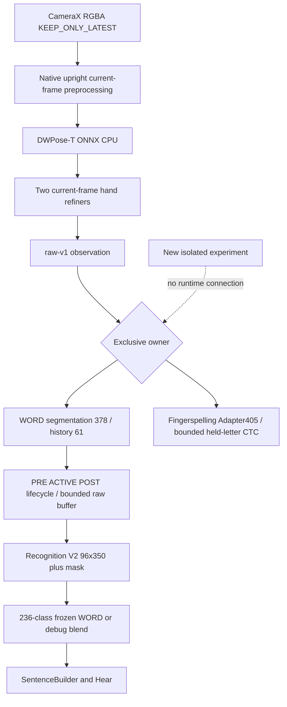

# Current architecture and experiment boundary

Status: SOURCE_TRACED; no production change. The workspace path and initial metadata fingerprint match the prior audit; full byte hashes are now saved.

Source references, relative to the repository root:
- RecognitionActivity.kt, start()/bindPhoneCamera(): model load off-main; 480x360 request, upright RGBA, KEEP_ONLY_LATEST, front15/rear30 request. Requested capture rate is not completed processing FPS.
- perceptionvnext/Candidate01FrameAnalyzer.kt: current-frame observation, exclusive ownsObservation dispatch, image.close() in finally; inference failure latches failed.
- PhoneCausalCore.kt: segmentation builder378, decoder133.308ms minimum ACTIVE /266.616ms POST /399.924ms rearm; buffer256 rows or30s. ACTIVE can outlive buffer; later materializer requires evicted start.
- PhoneProductionSession.kt: dense V2 view, top1 commit, SentenceBuilder; STABLE/experimental selection on session load.
- PhoneRecognitionConfiguration.kt: debug-only Arm A and WORD blends; STABLE default/release. No new experimental package is connected.
- FeatureFlags.RECOGNITION_ENABLED: declared but unused by the current main source.
- Fingerspelling: V2.1 epoch034,405 floats,28 logits; symmetric masked TCN,4-second genuine-observation window; singleton CTC acceptance with stability and hand-lowering rearm. Not fluent sentence recognition.
- pipeline/run_pipeline.py: legacy E-D-F orchestration; model/train*.py and eval/run.py write artifacts and must not be run blindly.
- pipeline/perception_vnext/offline_candidate01.py plus hand_refiner.py: reusable current-frame desktop perception; ONNX Runtime and TensorFlow Lite CPU. New data must keep its own provenance.
- pipeline/ingest/merge.py: no source/output overlap guard. New tools will reject identical or nested paths without editing that production file.

Known findings A-E will first receive isolated regression/source checks. Any runtime correction must be a separate, reviewed change after expected behavior is established. Existing production hashes and avatar choices remain frozen. No production baseline can be reproduced from absent private captures/features; report this limitation instead of scoring synthetic data as the app.

